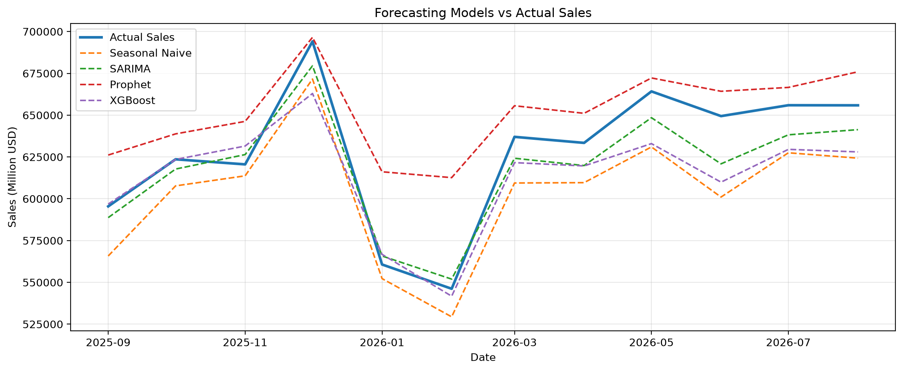
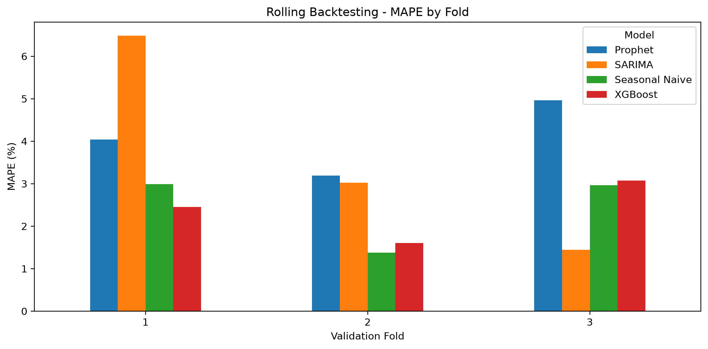

# US Retail Sales Forecasting

An independent time-series forecasting portfolio project comparing four methods for predicting monthly US retail sales: **Seasonal Naive, SARIMA, Prophet, and XGBoost**.

## Business question

How accurately can historical monthly retail sales predict the next 12 months, and do more complex forecasting methods improve on a simple seasonal benchmark?

## Data

- **Source:** [Federal Reserve Economic Data (FRED) — MRTSSM44000USN](https://fred.stlouisfed.org/series/MRTSSM44000USN)
- **Description:** US retail sales, not seasonally adjusted; units are **millions of US dollars**.
- **Notebook snapshot:** 416 monthly observations, January 1992–August 2026.
- **Training:** January 1992–August 2025 (404 observations).
- **Holdout:** September 2025–August 2026 (12 observations).

The notebook downloads the series from FRED and also saves a local snapshot as `data/us_retail_sales.csv`. FRED may publish additional observations or revisions in the future, so rerunning the download can produce a different sample and different evaluation figures. Use the accompanying CSV snapshot to reproduce the recorded data version.

## Methods

1. **Data preparation:** data type checks, missing-value and duplicate-date inspection, monthly date indexing.
2. **Exploratory analysis:** historical trend, monthly seasonality, year-over-year growth, additive seasonal decomposition.
3. **Forecasting models:**
   - Seasonal Naive: previous year's corresponding month.
   - SARIMA: `(1, 1, 1) × (1, 1, 1, 12)` (initial fixed configuration).
   - Prophet: yearly seasonality.
   - XGBoost: lag features (1, 2, 3, 12 months), month/year calendar features, recursive 12-month prediction.
4. **Evaluation:** MAE, RMSE, MAPE on a chronological 12-month holdout and three expanding-window rolling-origin validation folds within the training period.

### Holdout performance

| Model | MAE (million USD) | RMSE (million USD) | MAPE |
|---|---:|---:|---:|
| Seasonal Naive | 24,433.92 | 26,804.73 | 3.85% |
| **SARIMA** | **12,230.51** | **13,907.69** | **1.91%** |
| Prophet | 23,820.48 | 29,988.41 | 4.00% |
| XGBoost | 17,355.63 | 21,572.28 | 2.67% |

### Rolling-origin backtesting (three 12-month windows)

| Model | Mean MAE (million USD) | Mean RMSE (million USD) | Mean MAPE | MAPE standard deviation |
|---|---:|---:|---:|---:|
| **XGBoost** | **14,160.14** | **15,735.20** | **2.38%** | 0.74 |
| Seasonal Naive | 14,403.94 | 16,934.06 | 2.44% | 0.92 |
| SARIMA | 21,398.54 | 24,045.12 | 3.65% | 2.58 |
| Prophet | 23,650.72 | 27,460.98 | 4.06% | 0.88 |

**Interpretation:** SARIMA was best on the examined holdout period, while XGBoost had the lowest mean error across historical validation windows. XGBoost was selected as the preferred model based on rolling validation, but its 0.06 percentage-point mean MAPE advantage over Seasonal Naive is small; these results do not establish a reliable general superiority.

## Visualizations





## Repository contents

```text
us-retail-sales-forecasting/
├── us_retail_sales_forecasting.ipynb
├── README.md
├── requirements.txt
├── data/
│   └── us_retail_sales.csv
├── images/
│   ├── forecast_comparison.png
│   └── backtesting_comparison.png
└── results/
    ├── model_comparison.csv
    ├── backtesting_folds.csv
    └── backtesting_summary.csv
```

## Run locally

1. Install dependencies: `pip install -r requirements.txt`.
2. Start Jupyter: `jupyter notebook` (install Jupyter separately if needed).
3. Open `us_retail_sales_forecasting.ipynb` and run the cells top to bottom. The notebook's first data-loading cell fetches FRED data over the internet. For a reproducible run with the bundled snapshot, replace that initial `pd.read_csv(url)` with `pd.read_csv("data/us_retail_sales.csv")`.

## Limitations

- Three rolling validation windows provide only limited evidence of out-of-sample stability.
- The 12-month holdout was examined before the rolling-validation model selection; it is not a fully untouched final test in the strictest sense.
- Sales are nominal and not adjusted for inflation.
- External macroeconomic predictors and prediction intervals were not included.
- The fixed model settings were not selected via a separate hyperparameter search.

## Future improvements

Expand rolling-origin backtesting, tune models using training-only validation, introduce relevant economic indicators, evaluate prediction intervals, and build an interactive forecasting dashboard.

---

**Data credit:** FRED / US Census Bureau source series. This is an independent educational portfolio project using publicly available statistical data; it contains no private employer or client records.
